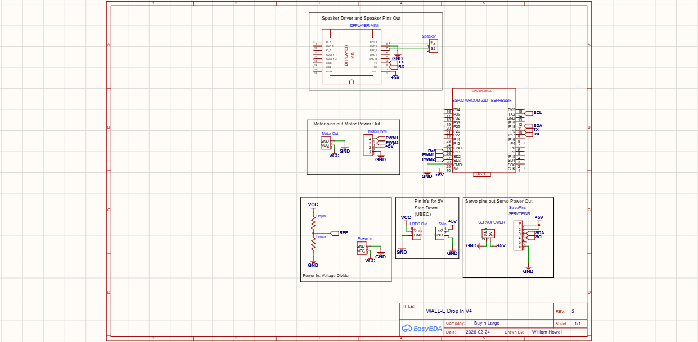
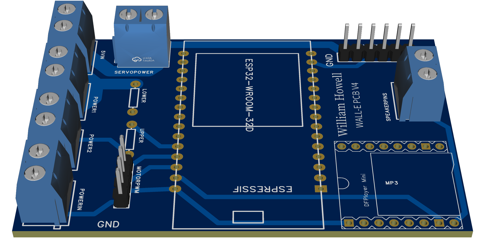

# DIY Wall-E Robot

Status: Completed

An ESP32-controlled WALL-E replica with independent track drive, seven servo mechanisms, Bluetooth gamepad control, sound playback, and a portrait OLED battery display.

## Overview

I built the robot around chillibasket's printed mechanical design and developed the electronics, custom motherboard, wiring, and Arduino firmware. The completed build runs Full Build V4 firmware on a 2S LiPo.

## Main Parts

- Controller: ESP32 Type-C 30-pin development board
- Gamepad input: Bluetooth through Bluepad32
- Servo control: PCA9685 PWM servo driver
- Drive control: dual-channel bidirectional brushed ESC
- Audio: DFPlayer Mini module and speaker
- Power: 2S 1500 mAh LiPo and 5 V 7 A UBEC
- Mechanical: 3D-printed body, arms, claws, and mounting parts
- PCB work: EasyEDA schematic and controller-board layout

## Mechanical Build

### 3D print files and original design credit

I obtained the original WALL-E 3D printer files from **Simon Bluett (chillibasket)** and built this robot around his WALL-E Robot Replica design. The original mechanical design is his work; my contribution includes the custom electronics, motherboard, ESP32 firmware, wiring, and adaptations for this build.

- [chillibasket's WALL-E replica repository](https://github.com/chillibasket/walle-replica)
- [Original build guide and model downloads](https://wired.chillibasket.com/3d-printed-wall-e/)

I printed and fitted the body and mechanisms, then adapted the chest panel to accommodate the OLED.

## V4 Motherboard and Schematic

The WALL-E Drop In V4 motherboard consolidates the ESP32, audio, motor-control, servo, battery, and power connections. I designed it in EasyEDA and ordered fabrication from JLCPCB.

## Firmware

Full Build V4 combines Bluepad32 gamepad input, tank steering, PCA9685 servo control, animations, DFPlayer audio, and OLED battery monitoring. It holds the ESC at neutral during startup, stops the tracks on controller disconnect, and limits active servo PWM to two channels.

### Controls

| Input | Action |
| --- | --- |
| Left / right stick vertical | Left / right track |
| A | Play audio |
| L2 / R2 | Toggle left / right arm |
| L1 / R1 | Look left / right; both center the head |
| X / B | Toggle left / right eye; hold to center |
| Y | Toggle neck position |
| D-pad | Servo animations |

### Source

Open the sketch folder in Arduino IDE and select the Bluepad32 ESP32 board configuration. Set `BATTERY_CELL_COUNT` to match the battery; the supplied sketch selects 2S. Required libraries are ESP32Servo, Adafruit PWM Servo Driver, U8g2, and DFRobotDFPlayerMini.

- [Full Build V4 Arduino sketch](firmware/WALL_E_Full_Build_V4/WALL_E_Full_Build_V4.ino)

## Parts and purchase prices

Prices below are historical USD item prices from my inventory and order records. Package prices are identified explicitly. Shipping and taxes are not included. The list covers the finished ESC-controlled, 2S build.

| Part / selected variant | Build quantity | Recorded price | Purchase link |
| --- | ---: | --- | --- |
| ESP32 Type-C 30-pin development board | 1 | $4.39 each | [AliExpress](https://www.aliexpress.com/item/3256808703453847.html) |
| JGB37-520 gear motor, 12 V, 200 RPM | 2 | $8.72 each | [AliExpress](https://www.aliexpress.com/item/3256805250852226.html) |
| PCA9685 16-channel servo driver | 1 | $2.87 each | [AliExpress](https://www.aliexpress.com/item/3256806112519208.html) |
| MG90S 180° metal-gear servo | 7 | $20.96 per 10-pack | [AliExpress](https://www.aliexpress.com/item/3256805639785749.html) |
| Dual-channel bidirectional brushed ESC, advertised 40 A × 2, 6–15 V, mixed control | 1 | $6.33 displayed listing price; original paid price unconfirmed | AliExpress; original item listing unavailable |
| 5 V 7 A UBEC | 1 | $5.21 each | [AliExpress](https://www.aliexpress.com/item/3256809278446011.html) |
| DFPlayer Mini | 1 | $5.77 per 5-pack | [AliExpress](https://www.aliexpress.com/item/3256808023570782.html) |
| 40 mm 4 Ω 3 W speaker | 1 | $2.85 per 2-pack | [AliExpress](https://www.aliexpress.com/item/3256806925518415.html) |
| 1.3-inch SH1106 I²C OLED, white, 128×64 | 1 | $2.16 each | [AliExpress](https://www.aliexpress.com/item/3256807385478388.html) |
| 2S 1500 mAh 45C LiPo, JST variant | 1 | $8.93 each | [AliExpress](https://www.aliexpress.com/item/3256806995815859.html) |
| 100 kΩ and 6.8 kΩ divider resistors | 1 each | $4.47 per 600-piece assortment | [AliExpress](https://www.aliexpress.com/item/3256810191764673.html) |
| KF301 two-pin screw terminals | As installed | $1.60 per 10-pack | [AliExpress](https://www.aliexpress.com/item/3256806456550715.html) |
| 2.54 mm male/female breakaway headers | Cut to fit | $1.92 per assorted package | [AliExpress](https://www.aliexpress.com/item/2255800687544049.html) |
| Dupont housings and crimp contacts | As installed | $2.71 per 620-piece kit | [AliExpress](https://www.aliexpress.com/item/3256802459986084.html) |
| Custom WALL-E motherboard | 1 order | $10.00 paid for fabrication; board count not recorded | [JLCPCB](https://jlcpcb.com/) |
| Filament for body, tracks, wheels, gears, head, arms and chest panel | 2 rolls | Estimated $20.00 per roll; $40.00 total | Printed locally; filament brand not recorded |
| M2.5 hex screws, bolts and nuts kit | 1 kit | $6.00 paid | Purchase link not recorded |
| Wire, solder, insulation and cable ties | As installed | Estimated $5.00 allowance | Workshop stock |
| microSD card for DFPlayer audio | 1 | Estimated $8.00 allowance | Existing card; model not recorded |
| Xbox wireless controller | 1 | Estimated $60.00 allowance | [Xbox controllers](https://www.xbox.com/accessories/controllers) |

Filament, microSD, controller, connector consumption, and assembly supplies use estimated costs.

### Estimated build cost

| Cost group | Amount |
| --- | ---: |
| Main electronics, motors, battery and seven servos | $64.58 |
| JLCPCB fabrication order | $10.00 |
| Two rolls of filament, estimated | $40.00 |
| M2.5 hardware kit | $6.00 |
| Connector/header allowance, estimated | $3.00 |
| Two divider resistors, estimated allocation | $0.02 |
| Wire, solder and assembly supplies, estimated | $5.00 |
| microSD card, estimated | $8.00 |
| **Robot total excluding Xbox controller** | **$136.60** |
| Xbox controller, estimated | $60.00 |
| **Total including controller** | **$196.60** |

The electronics subtotal allocates seven servos from a 10-pack, one DFPlayer from a 5-pack, and one speaker from a 2-pack. Connector costs use a $3.00 consumption allowance rather than charging the robot for entire kits. The fabrication amount is the reported $10 order cost, since the number of boards was not recorded. Filament assumes two rolls at $20 each; roll weight and brand were not recorded. Totals combine historical item prices with estimates and exclude separately unrecorded shipping and taxes.

The ESC rating and $6.33 price come from the identified listing screenshot. Package prices differ from the allocated cost of parts used in one robot.

## Portfolio

Portfolio page: [DIY Wall-E Robot](https://wchowellarchive.web.app/Projects/Walle/Walle.html)
