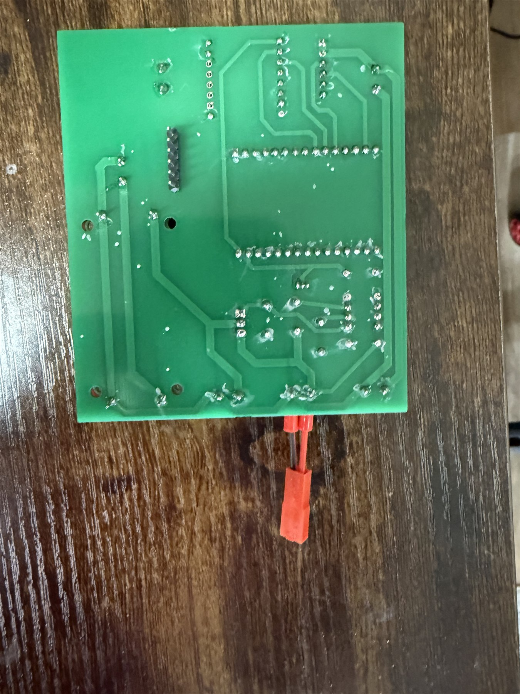
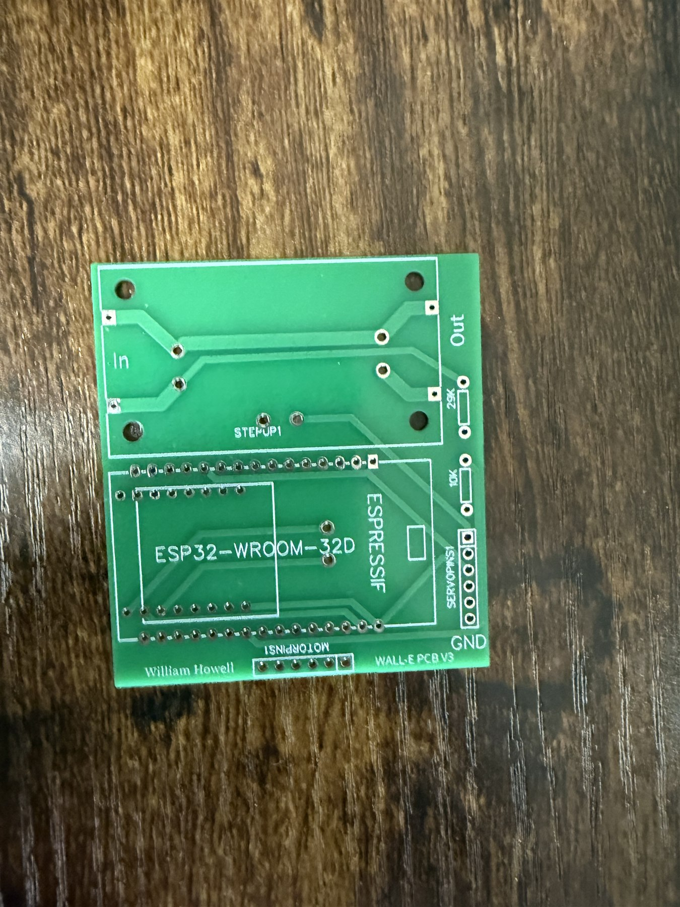

# DIY Wall-E Robot

Status: Working robot / active improvements

I built this Wall-E robot with an ESP32, two DC drive motors, servo-controlled arms and claws, Bluetooth gamepad control, a DFPlayer Mini, and 3D-printed parts. It drives, responds to the controller, moves its arms and claws, and plays audio.

## Overview

I started with a 3D-printed Wall-E body and rebuilt the electronics, wiring, and firmware around it. Everything fits inside the existing body, but the available space is extremely tight. I have built two controller-board revisions to reduce the loose wiring and make the electronics easier to package.

## Main Parts

- Controller: ESP32-family development hardware
- Gamepad input: Bluetooth through Bluepad32
- Servo control: PCA9685 PWM servo driver
- Drive control: L298N motor driver in the current documented build
- Audio: DFPlayer Mini module and speaker
- Power: 3S battery with separate motor and servo power requirements
- Mechanical: 3D-printed body, arms, claws, and mounting parts
- PCB work: EasyEDA schematic and controller-board layout

## Hardware

My documented build includes an ESP32-32S module, PCA9685 servo controller, L298N 12 V DC motor driver, XL6019 boost converter, DFPlayer Mini audio module, 4 Ohm 3 W speaker, 12 V motors, and MG90S metal servos.

## Mechanical Build

I 3D printed the body and alternate remix parts before final assembly. Printing alternate parts early helped reduce duplicate work and made it easier to adapt the mechanisms during the build.

## Controller PCB Revisions

I designed the controller boards in EasyEDA to collect the ESP32, audio, motor, servo, power, and battery connections on one board. I refer to the assembled board as Revision 1 and the smaller empty board as Revision 2 based on the order I fabricated them. Their silkscreen labels read `WALL-E PCB V2` and `WALL-E PCB V3` respectively.

### Revision 1: assembled and working

I fully assembled and tested the first board. It worked without functional problems, but it was larger than I wanted for the limited space inside Wall-E. The board carries the ESP32, DFPlayer Mini, boost-converter module, screw terminals, servo and motor connections, and the discrete power-protection parts.

### Revision 2: smaller but not assembled

The second board is much smaller and places plug-in modules on both sides. I decided not to assemble it because several modules would be held above the board mainly by their headers. I did not like having those parts mechanically unsupported inside a moving robot, so this revision was manufactured but never electrically tested.

## Packaging And Power Notes

The replacement electronics fit inside the existing printed body, but the fit is extremely tight. I also designed a different front panel to make room for the OLED display.

For another compact revision, I would replace the L298N and its boost converter with a dual motor ESC rated for a 3S battery. That would remove two of the larger modules from the build.

The servo supply also needs more current than a small buck-converter module can reliably provide. I recommend a 5 V, 8 A UBEC for the servo rail. I budget up to roughly 2 A for a stalled servo, so the firmware should limit how many high-load servo movements happen at the same time.

## Firmware

I wrote firmware separately from the original mechanical project. It uses Arduino/C++ and ESP32 controller support. I handle servo calibration before running the full robot program so correct travel limits can be entered into the main control logic.

Firmware source included in this repo:

- [firmware/Walle_code.cpp](firmware/Walle_code.cpp)

## Project Work

- ESP32 embedded firmware
- Bluetooth gamepad control
- PCA9685 servo driving
- DC motor control
- DFPlayer Mini audio control
- battery-powered robotics wiring
- 3D-printed body, arm, and claw assembly
- controller PCB design, manufacturing, assembly, and revision testing
- debugging across the wiring, firmware, motors, servos, and printed mechanisms

## Testing

The assembled robot operates with its motor, servo, Bluetooth-control, and audio systems. The portfolio page includes the working build, parts, schematic and PCB work, firmware, and a demo video.

The assembled first controller board worked fully in testing, with size as its main drawback. The smaller second board was manufactured but intentionally left unassembled, so I do not claim that revision as electrically tested.

## Future Improvements

- Add a complete pin map and PCA9685 channel table.
- Document servo calibration values.
- Add power architecture and battery-protection notes.
- Add measured current draw for motors, servos, and idle electronics.
- Design another compact controller-board revision with better mechanical support for every module.
- Evaluate a dual 3S motor ESC as a replacement for the L298N and boost converter.
- Add a short demo video or linked media section.

## Portfolio

Portfolio page: [DIY Wall-E Robot](https://wchowellarchive.web.app/Projects/Walle/Walle.html)
